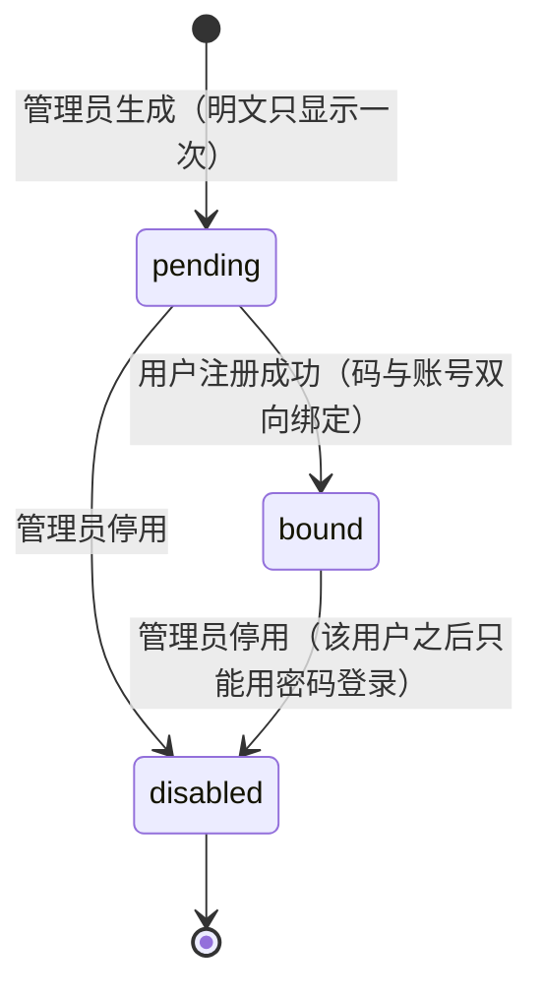

# PRD：账号注册 · 邀请码绑定 · 归属统一

- **状态**：已与作者确认需求（2026-10-07），待实现
- **作者决策记录**：Q1=C+留痕 / Q2=A / Q3=先做 A（脚本，不做管理页）/ Q4=自动登录 /
  Q5=按建议收紧 / Q6=关掉空码开放注册 / Q7=迁移到管理员账号 / 孤儿 Bug=排查并根治

---

## 一、背景与目标

### 问题
1. 注册接口与用户名密码登录**后端已完整**，但**没有任何界面**，`.env.example` 自己写着
   "API registration has no full UI yet"。用户拿不到码、注册不了。
2. 邀请码只是 `.env` 里的静态映射（`码:用户id`），**无法记录"这个码用没用、给了谁"**，
   因此做不到一码一人，也无从追溯。
3. 作者存在**两个 owner 身份**：`beta-user-001`（邀请码、6 个项目、`users` 表无此行）
   与 `ec1ec540af85`（用户名 `W` + 密码、1 个项目）。作品分散在两处，无法统一管理。
4. 空邀请码配置时**任何人可注册**（`_allowed_invite` 返回 `True`），是颗雷。
5. 遗留 Bug：项目「private」的 owner `c7836e0fa58a` 在 `users` 表已无记录（孤儿），
   该作品除管理员外无人可访问。

### 商业目标
从"受控 Beta 邀请制"走向"可发码、可追溯、可自注册"的真实用户体系。**不做**会怎样：
无法安全地把产品交给下一个人用（只能共享你的管理员密码）。

### 成功指标（可衡量）
- 新用户**无需你介入**即可完成注册→登录→建项目全流程（除"拿到码"这一步）。
- 你随时能回答三个问题，且答案是**查出来的、不是猜的**：
  ① 我发出去几个码？② 哪些还没被用？③ 每个码绑给了谁、什么时候绑的？
- 真实库中**不存在孤儿 owner**（`projects.owner_id` 必须有对应的 `users` 行或管理员白名单）。
- 注册相关失败的**原因可区分**：码无效 / 码已被使用 / 码已停用 / 用户名被占用 / 密码不合规。

---

## 二、用户分析

| 角色 | 场景 | 当前怎么办 | 痛点 |
|---|---|---|---|
| **作者（你，管理员）** | 想给朋友一个账号 | 手动改 `backend/.env` → 重启后端 → 把码发出去 | 重启才能生效；码可以无限次用；用完不知道 |
| **新用户** | 收到码，想开始用 | **没有注册入口** | 只能等你手动建账号 |
| **新用户（回流）** | 隔天再来 | 输账号密码 | 已可用（后端支持） |
| **老身份（你自己）** | 继续用旧码免密码进 | 输码直接进 | 6 个项目与账号分离，心里没底 |

---

## 三、功能规格

### 3.1 邀请码语义（核心）

采用 **C（码 = 账号的登录凭据）+ 留痕**，并保留老免密码通道（Q2=A）：

| 状态 | 能否用于注册 | 能否当凭据登录 | 含义 |
|---|---|---|---|
| `pending` | ✅（只能用一次） | ❌ | 你发出去的、还没人认领的码 |
| `bound` | ❌（已被认领） | ✅（进绑定账号） | 已和某个账号绑定 |
| `disabled` | ❌ | ❌ | 你手动停用 |

**状态机**



**不变式**
- 一个码**最多绑定一个账号**；一个账号**可以有多个码**（你换发码时旧的停用即可）。
- `pending` 码**不能**直接登录（它还没有归属账号，无法判断"进谁的账号"）——
  界面要明确提示"这个码还没被注册，请先注册"。
- 老 `.env` 码**行为不变**（继续免密码直接进），不属于上表状态机（Q2=A）。

### 3.2 注册

- 入口：现有「受控 Beta 访问」弹层里加**模式切换**：`登录` / `注册` / `用邀请码进入`。
- 注册表单字段：**邀请码** + **用户名** + **密码** + **确认密码**。
- 成功后**自动登录**（直接种会话 cookie 并进入创作台），不需要再去登录一次。
- 校验与文案（**必须可区分**）：

| 情况 | HTTP | 文案 |
|---|---|---|
| 码为空 / 无效 / 不存在 | 403 | 邀请码无效，请检查是否输错。 |
| 码已被使用 | 403 | 该邀请码已被使用，请向邀请人索取新码。 |
| 码已停用 | 403 | 该邀请码已被停用。 |
| 用户名已存在 | 409 | 该用户名已被占用，换一个吧。 |
| 密码不合规 | 400 | 密码至少 8 位，且不能与用户名相同。 |

### 3.3 用户名与密码规则（Q5）

- **用户名**：去首尾空白后 **3–30 字符**；允许中文、英文字母、数字、`_`、`-`；
  **禁止空格、全角空格与其它符号**。
- **唯一性：不区分大小写**（`W` 与 `w` 视为同一个），新增函数式唯一索引
  `lower(username)`。现有 `users` 表仅 1 行（`W`），无冲突风险。
- **实时占用提示**：注册模式下，用户名输入框失焦时查询一次占用状态；
  接口 `GET /api/auth/username-available?username=...` → `{available: bool}`。
  **接受"可枚举用户名"的代价**（注册表单的固有取舍），该接口纳入既有 auth 限流。
- **密码**：≥8 位，且**不能与用户名相同**（大小写不敏感比较）。

### 3.4 登录（新老并存）

| 输入 | 行为 |
|---|---|
| 用户名 + 密码 | 登录该账号（既有逻辑不变） |
| 只有邀请码 | **`bound` 码** → 登录绑定账号；**老 `.env` 码** → 进映射账号；**`pending` 码** → 403「这个邀请码还没被注册，请先注册。」 |

### 3.5 你能操控邀请码（Q3，先做 A）

新增命令行工具 `backend/scripts/invite_tool.py`：

```
python scripts/invite_tool.py new --count 3 --label "10月批次"   # 生成，明文只打印这一次
python scripts/invite_tool.py list                              # 表格：hint/label/状态/绑定给谁/时间（不含明文）
python scripts/invite_tool.py disable --hint ab12               # 停用（或 --id）
```

- **明文只在生成时显示一次**，库里存 `sha256(码)` + `code_hint`（后 4 位）+ `label`。
  理由：C 语义下码就是凭据，泄露即等于账号被拿。
  **可覆盖**：若你更希望"随时能重新查看已发出的码"，需改成明文存储（安全性更低），说一声即可。
- 你只要说"给我 N 个码"，我跑一条命令把码贴给你。
- 管理页面（Q3 的 B）**明确不做**，留给你后期那个可视化后端管理页面。

### 3.6 「我的邀请码」（前端）

`AccountPage` 增加一块：显示当前账号绑定的码的 `hint`（如 `••••ab12`）与绑定时间，
**不回显明文**（库里只有哈希）。用途：让用户知道自己手上那把"备用钥匙"是哪一把。

### 3.7 关掉空码开放注册（Q6）

- `_allowed_invite` 不再在 `invite_tokens` 为空时放行；**空配置 = 拒绝注册**。
- `DEBUG=true` 时的 `local-dev` 兜底身份**保留不变**（本地开发依赖它）。

### 3.8 归属统一与孤儿根治（Q7 + Bug）

**一次性迁移**（脚本 `backend/scripts/migrate_legacy_owner.py`）：

| 表 | 字段 | 从 | 到 | 行数 |
|---|---|---|---|---|
| `projects` | `owner_id` | `beta-user-001` | `ec1ec540af85` | 6 |
| `projects` | `owner_id` | `c7836e0fa58a`（孤儿） | `ec1ec540af85` | 1 |
| `outline_candidates` | `user_id` | `beta-user-001` | `ec1ec540af85` | 19 |
| `user_sessions` | `user_id` | **不动** | — | 0 |

- **`.env` 的 `INVITE_TOKENS` 映射改为 `→ ec1ec540af85`**，让两条路收敛到同一个身份；
  `ADMIN_USER_IDS` 保留两个 id（无害，留后路）。
- 脚本要求：**默认 dry-run**（只打印将改动的行数）、`--apply` 才写、
  **写前强制备份** `data/backups/<db>.<UTC时间戳>.bak`、**幂等**（跑两次第二次 0 行）、
  失败即回滚事务。
- **孤儿根治**：
  1. 删掉死代码 `dao/users.py: delete_user()`（无校验版，就是它当年能删掉有项目的用户）。
  2. 新增 `backend/scripts/check_orphan_owners.py`：**只报告不修**（自动改归属更危险）。
  3. 新增回归测试：注销用户后不得出现孤儿 owner。

---

## 四、技术约束与边界

**必须遵守的既有不变量**
- 注册/邀请码**绝不写 `style_bindings`**（本项目历史上栽过：参考档案误入文风绑定）。
- `user_sessions` 只增删本人会话；迁移**不触碰**你的 4 条现有会话（否则你被踢下线）。
- 邀请码校验**必须**复用既有 auth 尝试限流（`main.py` 的 `_AUTH_ATTEMPT_PATHS` 已含 `/api/auth/register`）。
- 前端类型与请求体**必须**同步改 `src/types/index.ts` + `src/services/api.ts`（本项目约定：后端 snake_case → 前端 camelCase 由 `normalize*` 函数转换）。
- 新增表用 `CREATE TABLE IF NOT EXISTS` + `_ensure_column` 追加列，**不做有风险的老表重建**
  （唯一例外：本轮不涉及）。

**异常与降级**
- 邀请码表不存在/损坏 → 注册路径报 403 而非 500；**不能**因为邀请码校验异常把老 `.env` 通道也弄挂。
- `username-available` 超时 → 前端**不阻塞**提交（退化为服务端 409 提示）。

**明确不做（Out of scope）**
- 邮件/短信验证、找回密码、第三方登录。
- 邀请码管理界面（留给你后期那个后端管理页）。
- 码的有效期/次数上限（当前只有"一次性"这一个约束）。
- 多管理员、角色体系。

---

## 五、验收标准（Given/When/Then）

**注册**
1. Given 一个 `pending` 码，When 用「码 + 未占用用户名 + 合规密码 + 一致确认密码」注册，
   Then 201/200 且**响应即带会话 cookie**（自动登录）、码变 `bound` 且 `used_by_user_id` 是新账号。
2. Given 同一个码，When **第二个人**用它注册，Then 403「该邀请码已被使用」。
3. Given 一个 `pending` 码，When 用**已存在的用户名**注册，Then 409，**且码仍为 `pending`**（不消耗）。
4. Given 一个 `disabled` 码，When 注册，Then 403「已被停用」。
5. Given 密码与用户名相同 / 密码 7 位，When 注册，Then 400（不得静默接受）。
6. Given `INVITE_TOKENS` 为空配置，When 不填码注册，Then **403**（不再是放行）。

**登录**
7. Given 已注册账号，When 用「用户名+密码」，Then 登录成功。
8. Given 一个 `bound` 码，When 只提交该码，Then 登录**绑定账号**（C 语义）。
9. Given 一个 `pending` 码，When 只提交该码，Then 403 且文案引导去注册。
10. Given 一个 `disabled` 码（曾 `bound`），When 只提交该码，Then 403；
    When 改用用户名+密码，Then **仍能登录**（停用码不等于封号）。
11. Given 老 `.env` 码，When 只提交它，Then **行为与改造前完全一致**（回归钉子）。

**可见性与操控**
12. Given 新生成的码，When 运行 `list`，Then 能看到 hint/label/状态/绑定账号/时间，**看不到明文**；
    When 再次运行 `new`，Then 明文与已发出的任何码**都不相同**。
13. Given 已用过的码，When 在 `AccountPage` 查看，Then 显示 hint 与绑定时间，**不显示明文**。

**迁移与孤儿**
14. Given 迁移前状态（6+1 个项目、19 条候选），When dry-run，Then **不写库**且打印将改动的行数；
    When `--apply`，Then 备份文件存在、项目归属全部为 `ec1ec540af85`、`user_sessions` 行数**不变**；
    When 再跑一次 `--apply`，Then 改动 0 行（幂等）。
15. Given 迁移后，When 用你的账号密码登录，Then 能看到**全部 8 个项目**（含原 `beta-user-001` 的 6 个）。
16. Given 任意时刻，When 运行 `check_orphan_owners.py`，Then 输出"无孤儿"。
17. Given 一个名下**没有项目**的用户，When 注销，Then 成功；且此后**不存在孤儿 owner**。

**非功能**
18. 全后端套件、前端单测、E2E、`tsc --noEmit`、`build` 全绿；真实 LLM 调用 **0 次**。
19. 反向验证：至少 3 处（去掉"码一次性"、去掉"空码拒绝"、去掉"迁移幂等/备份"）
    必须**按预期变红**再还原。

---

## 六、埋点与可观测

- 注册成功/失败按**原因**计数（码无效 / 已被使用 / 已停用 / 用户名占用 / 密码不合规）。
- 邀请码 `list` 的 `pending/bound/disabled` 三个计数（你现在唯一需要盯的运营数字）。
- `check_orphan_owners.py` 的输出可作为交付前的固定检查项。

---

## 七、风险与取舍

| 风险 | 严重度 | 处置 |
|---|---|---|
| 迁移写错 owner → 作品归属混乱 | 🔴 高 | 强制备份 + dry-run 默认 + 幂等 + 事务；迁移前后打印行数；先备份再动 |
| **C 语义下码泄露 = 账号被拿** | 🔴 高 | 码存哈希、明文只显示一次、可随时停用、密码是主凭据 |
| 用户名不区分大小写去重改变既有行为 | 🟡 中 | 现有仅 1 个用户（`W`），无冲突；加测试钉住 |
| 空码配置关闭后影响现有部署 | 🟡 中 | 你当前已配置了码，线上无影响；`.env.example` 与文档同步说明 |
| "参考感"式的**自证陷阱**：我无法替用户验证注册体验好不好 | 🟡 中 | 交付后请你**亲手走一遍**注册全流程（我会给你一个测试码） |

---

## 八、任务拆解与 Agent 分配

> 见对话中的「任务拆解与分配」表。

## 九、待确认（实现前不打结的点）

1. 库里的码**只存哈希**（明文只显示一次）—— 确认接受；若要"随时查看明文"，请明说。
2. 迁移是否**同时**把孤儿项目「private」并入你的账号（我按"可以"理解，会一并迁）。
3. 迁移是否需要我**同时改 `.env` 的映射**指向 `ec1ec540af85`（我按"需要"理解）。
